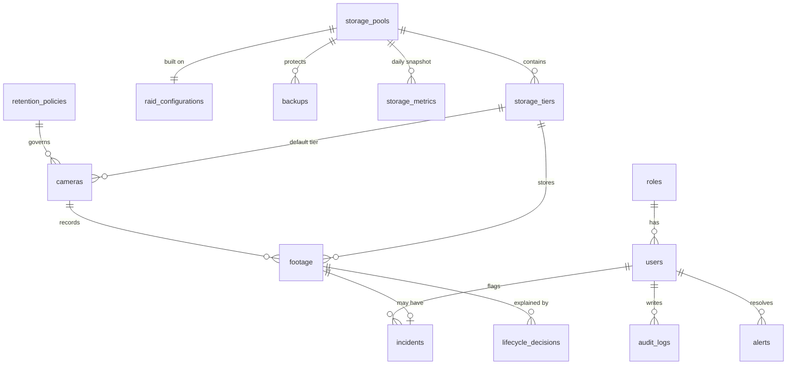

# ER Diagram

**Reading it:** a *pool* (usable capacity from RAID) is split into three *tiers*. *Cameras* record *footage* metadata rows that
sit on one tier. Footage may carry an *incident* (and legal hold). Every automatic move is recorded in *lifecycle_decisions*
with its reason (explainability). *storage_metrics* holds one row per simulated day (forecast input). *alerts*,
*audit_logs* and *system_settings* (thresholds, RPO/RTO, simulation clock) are cross-cutting.

Key constraints: UNIQUE(username), UNIQUE(pool,tier_name), UNIQUE(footage_id) on incidents, CHECK(end_time > start_time),
CHECK on every enumerated column, partial UNIQUE index on open alert `dedup_key`, trigger `trg_protect_footage`.
Indexes: footage(camera_id,start_time), (tier_id), (retention_expiry), (importance), (deletion_status); alerts(status,severity);
audit_logs(created_at), (user_id); backups(started_at).
